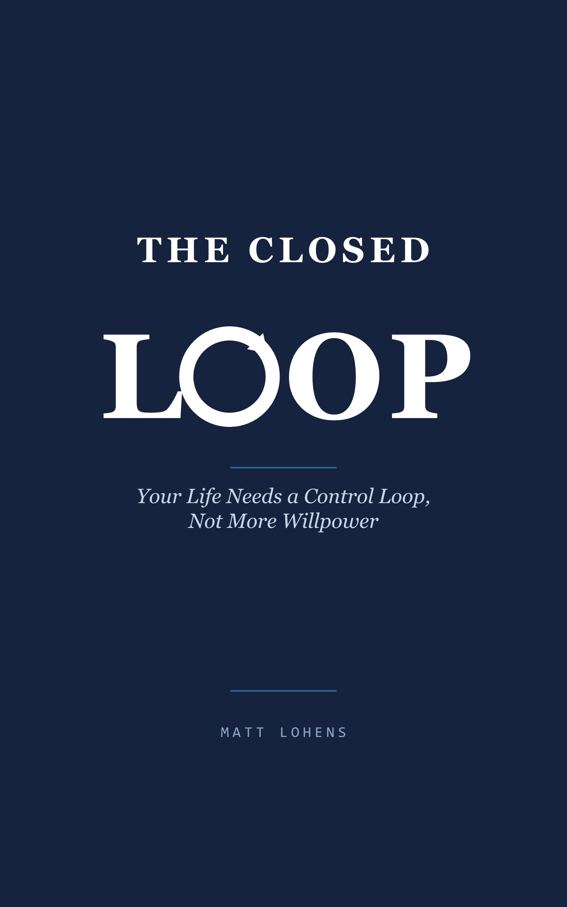

# The Closed Loop — Implementation Prompt

The companion AI system prompt for *The Closed Loop* by Matt Lohens.

> Your life doesn't need more willpower. It needs a control loop.

*The Closed Loop* is a book about replacing willpower-based habit advice with an actual engineered control loop: a reference signal (morning), a measurement and correction (evening), and a weekly tuning pass — run with nothing but a phone and a free AI chat app.

**[Get the book on Amazon](https://www.amazon.com/dp/B0HHBW6421)**

## What's in this repo

[`closed-loop-implementation-prompt.md`](closed-loop-implementation-prompt.md) is the canonical, up-to-date version of the Assistant instructions and the Morning / Evening / Weekly prompts described in the book. It's kept current here so readers always have the latest version, independent of the print/ebook text.

## How to use it

1. Open the prompt file above and copy the **Assistant instructions** section into any capable AI chat, once.
2. Set up triggers — start with two daily phone alarms ("Priorities?" and "Reflection?"), then move to scheduled messages once the ritual survives a few real weeks. See the "Trigger setup" section in the prompt file for details.
3. Replace the bracketed placeholders with your own variables and times.

The file will be updated as the system evolves — check the changelog at the bottom of the prompt file for version history.

## License

This prompt is shared for personal use by readers of the book. All rights to *The Closed Loop* remain with the author.
